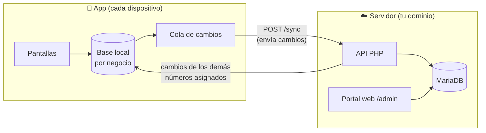

<p align="center">
  
</p>

<h1 align="center">Facturas</h1>

<p align="center">
  Facturación y cobros para equipos pequeños: facturas, abonos y recibos en PDF,<br>
  con trabajo sin conexión y sincronización entre todos los dispositivos.
</p>

<p align="center">
  
  
  
  
  
</p>

---

## Contenido

- [Funciones](#funciones)
- [Cómo funciona](#cómo-funciona)
- [Primer uso](#primer-uso)
- [Desarrollo](#desarrollo)
- [Generar el APK](#generar-el-apk)
- [iPhone e iOS](#iphone-e-ios)
- [Pruebas](#pruebas)
- [Estructura del proyecto](#estructura-del-proyecto)

## Funciones

| | |
|---|---|
| **Facturas** | Cliente, fechas, conceptos, IVA y observaciones. Se editan mientras no tengan pagos. |
| **Abonos y pagos** | Pago total o parcial con historial. La factura queda pagada cuando los pagos cubren el total. |
| **PDF** | Factura y recibo de cada pago (`RC-0001`) con el logo del negocio, listos para imprimir o compartir. |
| **Sin conexión** | Todo se guarda en el móvil. Una factura creada sin señal queda como *borrador* y recibe su número (`F-0001`) al sincronizar. |
| **Equipo** | Varias personas comparten las mismas facturas. Si dos cobran a la vez y se supera el saldo, el servidor lo impide y la app lo avisa. |
| **Varios negocios** | Una persona puede trabajar en varios negocios y cambiar entre ellos. Cada uno tiene sus propios datos, emisor y numeración. |
| **Roles** | Los *miembros* facturan y cobran; los *administradores* además gestionan el emisor y pueden eliminar pagos. |
| **Apariencia** | Modo claro, oscuro o el del sistema. Tipografía IBM Plex Sans con cifras alineadas. |

> [!NOTE]
> El equipo, las contraseñas y los negocios se gestionan desde el **portal web**, que también permite facturar desde el navegador (por ejemplo, desde un iPhone). El servidor y el portal están en el repositorio de la API.

## Cómo funciona

La app guarda una copia local de los datos de cada negocio y una **cola de cambios**. Al haber conexión, envía sus cambios al servidor y recibe los de los demás dispositivos. El servidor numera las facturas y los recibos y valida los pagos, así que nunca se repite un número ni se cobra de más.



Lo que se sincroniza: facturas, pagos y datos del emisor. La app sincroniza al abrirse, tras cada cambio, cada minuto y al deslizar hacia abajo en la lista. El icono de la nube muestra el estado: sincronizado, cambios pendientes, sin conexión o error.

## Primer uso

> [!NOTE]
> En este documento, `tu-dominio.com` representa el **dominio registrado** del servidor. La dirección que la app trae por defecto se define en `lib/services/api_client.dart` (`defaultServerUrl`): cámbiala por la de tu servidor antes de generar el APK.

1. Instala el APK. El campo **Servidor** ya viene con la dirección del servidor de producción.
2. Inicia sesión con tu usuario.
   - Si el servidor está vacío, la app pide crear el primer negocio. Esa cuenta será la de **superadministrador**.
   - Si trabajas en varios negocios, eliges con cuál empezar; luego cambias desde *Perfil* o tocando el nombre del negocio.
3. Si el dispositivo tenía facturas de una versión anterior, la app pregunta si **subirlas** al servidor (conservando sus números y pagos) o descartarlas.

> [!TIP]
> Los usuarios del equipo los crea un administrador en el portal web: `https://tu-dominio.com/admin`.

## Desarrollo

**Requisitos**

- Flutter 3.47 o superior, con Dart 3.
- Android SDK con NDK 28.2.
- Para probar en Windows, el **Modo de desarrollador** de Windows activado.

> [!WARNING]
> Con Java 25, la herramienta de Android no reconoce la versión. Define la variable de entorno `SKIP_JDK_VERSION_CHECK=1` antes de compilar.

**Ejecutar**

```powershell
flutter pub get

flutter run -d windows                                  # Windows, ventana tamaño móvil
flutter run -d windows --dart-define=PREVIEW=ios        # dentro del marco de un iPhone 16
flutter run -d windows --dart-define=PREVIEW=android    # dentro del marco de un Galaxy S25
```

En VS Code, estas tres opciones están en *Run and Debug*.

**Servidor local**

| Dónde se prueba | Dirección del servidor |
|---|---|
| Windows, con Apache de WAMP | `http://localhost/facturas_api/public` |
| Móvil en la misma red Wi-Fi | `http://IP-DEL-PC:8080` (con `php -S 0.0.0.0:8080 -t public public/index.php` en la API) |

> [!IMPORTANT]
> Las direcciones `http://` solo funcionan en compilaciones de **depuración**. El APK de producción solo se conecta por **HTTPS**.

## Generar el APK

```powershell
flutter build apk --release
```

Se genera **un único APK universal** en `build/app/outputs/flutter-apk/app-release.apk` (unos 64 MB). Incluye las versiones de 32 y 64 bits y se instala en cualquier teléfono Android 7.0 o superior.

> [!WARNING]
> **No repartas APK separados por procesador** (`--split-per-abi`). Muchos móviles económicos, como el Samsung Galaxy A04, traen Android de **32 bits** aunque su procesador sea de 64, y rechazan el APK `arm64-v8a` con el mensaje *"no es compatible con el teléfono"*. El APK `x86_64` solo sirve para emuladores. Además, los APK separados usan otra numeración interna de versión (1002, 2002…), y mezclarlos con el universal impide actualizar.

Antes de cada entrega:

- **Sube la versión** en `pubspec.yaml` (por ejemplo, `version: 1.1.1+3`). El número tras el `+` debe aumentar siempre para que Android lo instale como actualización.
- **Firma siempre con la misma clave.** Así la actualización se instala encima sin perder datos. Si la clave cambia, habrá que desinstalar la app en cada móvil. Guarda una copia segura de la clave (`debug.keystore` o tu propia clave de firma) **fuera del repositorio**.

## iPhone e iOS

La app de iOS todavía no se distribuye. Quienes usan iPhone trabajan desde el **portal web** con el *acceso web* activado por su administrador; ahí pueden facturar, registrar pagos e imprimir en PDF.

El proyecto ya tiene la carpeta `ios/` preparada, con el ícono y los permisos. Para compilarla hace falta un Mac o un servicio como Codemagic (ver `codemagic.yaml`).

## Pruebas

```powershell
flutter analyze
flutter test
flutter test test/sync_integration_test.dart --dart-define=API_URL=http://127.0.0.1:8080
```

| Prueba | Qué comprueba |
|---|---|
| `invoice_test` | Totales, saldo, redondeos y formato de moneda |
| `invoice_repository_test` | Borradores, cola de cambios y datos que llegan del servidor |
| `migration_test` | Que actualizar desde una versión antigua no pierde facturas, conceptos ni pagos |
| `pdf_service_test` | Generación de facturas y recibos en PDF |
| `sync_integration_test` | Varios dispositivos y negocios contra la API real: conflictos de pagos, permisos y cambio de negocio |

> [!CAUTION]
> La prueba de integración crea usuarios y facturas. Ejecútala siempre contra una **base de datos de pruebas vacía**, nunca contra la de producción.

## Estructura del proyecto

<details>
<summary>Ver la estructura</summary>

```
lib/
├── main.dart                 arranque, tema claro/oscuro, vista previa de móvil
├── models/                   Invoice, InvoiceItem, Payment, Issuer
├── data/
│   ├── database_helper.dart  base local por negocio (sqflite) y migraciones
│   ├── outbox.dart           cola de cambios pendientes de enviar
│   ├── invoice_repository.dart
│   └── issuer_repository.dart
├── services/
│   ├── api_client.dart       peticiones HTTP y servidor por defecto
│   ├── auth_service.dart     inicio de sesión, negocio actual y cambio de negocio
│   ├── sync_service.dart     sincronización con el servidor
│   └── pdf_service.dart      factura y recibo en PDF
├── screens/                  login, elegir negocio, inicio, detalle, formulario, emisor, perfil
├── theme/app_theme.dart      colores, tipografía y modos claro/oscuro
└── widgets/                  estado de factura, sincronización y diálogos
assets/
├── fonts/                    IBM Plex Sans (app y PDF)
└── icon/                     ícono de la app
test/                         pruebas automáticas
```

</details>
